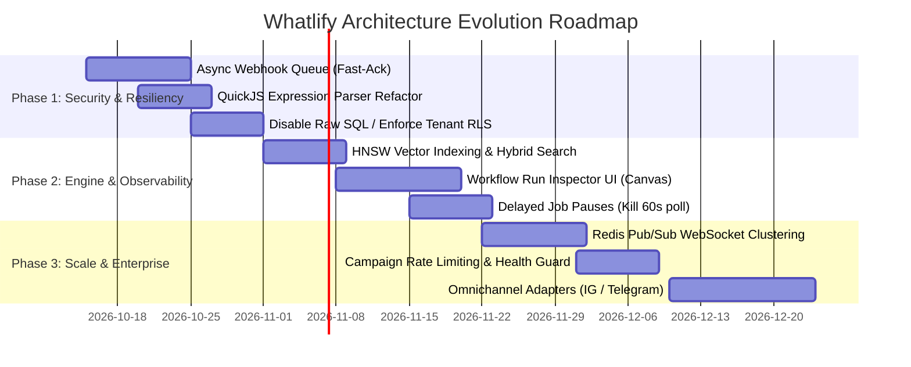

# Whatlify Architecture Evolution & Scaling Blueprint

**Author:** Antigravity Engineering  
**System:** Whatlify (WhatsApp-Hub-Suite)  
**Target State:** Enterprise-Grade, Horizontally Scalable, High-Resilience WhatsApp Automation & CRM Platform  
**Status:** Architecture Proposal & Action Plan  

---

## Executive Summary

Whatlify is already a feature-rich platform uniting Meta WhatsApp Cloud API, visual DAG workflow orchestration, LangChain RAG, a shared omnichannel inbox, and CRM capabilities. 

However, as message volume increases and multi-tenant workloads expand, the current architecture faces critical bottlenecks in:
1. **Synchronous Webhook Handling** (risk of Meta timeout cascading and duplicate message storms).
2. **Execution Sandboxing & Tenant Boundaries** (expression evaluation security & raw SQL isolation).
3. **In-Memory State & Single-Node Coupling** (WebSocket broadcast isolation & 60s interval polling).
4. **Vector & Database Scalability** (pgvector indexing, connection pooling, and tenant query optimization).
5. **WhatsApp Rate Limiting & Delivery Compliance** (Meta messaging tiers, exponential backoff, and campaign throughput controls).

This document outlines a phased, production-grade architectural evolution to scale Whatlify to millions of daily messages with 99.99% uptime, airtight tenant isolation, and sub-50ms webhook acknowledgment.

---

## 1. Current State vs. Target State Architecture

```mermaid
flowchart TB
    subgraph Current ["Current Architecture (Monolithic & Synchronous)"]
        Meta1["Meta Cloud API"] -->|POST Webhook| Express1["Express HTTP Handler"]
        Express1 -->|Sync| DB1[(PostgreSQL)]
        Express1 -->|Sync| LLM1["OpenAI API (8-15s)"]
        Express1 -->|Sync| DAG1["In-Process DAG Engine"]
        Express1 -->|In-Memory| WS1["In-Memory WebSocket Map"]
        Express1 -->|60s Polling| Poll1["workflow_pauses Interval"]
    end

    subgraph Target ["Target Architecture (Event-Driven, Decoupled & Distributed)"]
        Meta2["Meta Cloud API"] -->|POST Webhook| Gateway["Webhook Ingestion Gateway"]
        Gateway -->|< 50ms ACK (200 OK)| Meta2
        Gateway -->|Push Event| Queue["Durable Queue (Redis / BullMQ / pg-boss)"]
        
        subgraph Workers ["Stateless Distributed Worker Pool"]
            W1["Workflow Execution Worker"]
            W2["Campaign Broadcast Worker"]
            W3["RAG Document Ingestion Worker"]
        end
        
        Queue --> W1 & W2 & W3
        W1 --> QuickJS2["QuickJS WASM Sandboxed VM"]
        W1 --> SafeParser["Safe AST Expression Engine"]
        W1 --> DB2[(PostgreSQL + pgvector HNSW Index)]
        
        W1 --> PubSub["Redis Pub/Sub"]
        PubSub --> WSHub["Distributed WebSocket Gateway"]
        WSHub <--> Clients["React Clients"]
        
        Queue -->|Scheduled / Delayed Jobs| W1
    end
```

---

## 2. Core Pillars of Evolution

### Pillar 1: Decoupling Webhooks with Asynchronous Queue Pipeline

#### The Problem
In `server/routes.ts` (`POST /api/webhook`), inbound WhatsApp messages trigger database operations, typing indicators, media fetching, and DAG workflow execution synchronously within the HTTP request. Meta's webhook timeout is **3 to 5 seconds**. When a workflow invokes an LLM (often taking 4–12s) or external APIs, Meta closes the socket with a 504/timeout and immediately retries the message delivery. This causes:
- Infinite duplicate message execution loops.
- Exploding OpenAI API token costs.
- Database connection exhaustion.

#### The Solution: Fast-Ack Webhook Ingestion Engine
1. **Immediate Acknowledgment (<50ms)**:
   - Verify `x-hub-signature-256` HMAC.
   - Extract `wabaId` and push the raw payload to a fast FIFO queue (`BullMQ` or Postgres transactional outbox via `pg-boss`).
   - Instantly return `res.status(200).send("EVENT_RECEIVED")`.
2. **Worker Processing**:
   - A dedicated worker process consumes jobs from the queue with deduplication based on `message.id`.
   - Idempotency check: atomic Redis key `setnx(wa_msg:<id>, 1, EX 86400)` or database unique constraint on `whatsappMessageId`.
   - Dispatch to CRM conversation thread and trigger active automation workflows.

---

### Pillar 2: Security & Execution Hardening

#### 1. Safe Expression Parser (Replace Node.js `vm`)
- **Current Vulnerability**: `server/expression-parser.ts` evaluates `{{ ... }}` expressions using Node's standard `vm.Script`. In Node.js, `vm` is not a secure boundary and can be escaped to run host commands.
- **Fix**: 
  - Standardize all expression execution into either:
    1. **AST-based safe evaluators** (e.g. `jsep` or `expr-eval`) for basic template expressions `{{ $json.order.id }}`.
    2. **QuickJS WebAssembly VM** (already implemented in `server/nodes/code.node.ts`) for multi-line expressions and computations with rigid gas/CPU limits (100ms max CPU, 32MB max heap).

#### 2. Air-Tight Multi-Tenant Isolation & SQL Guardrails
- **Current Vulnerability**: `server/nodes/database.node.ts` allows `queryType === "raw"`, executing unconstrained `sql.raw(rawQuery)`. A tenant could potentially query cross-container records.
- **Fix**:
  - Restrict `rawQuery` execution strictly to system administrators or disable it entirely in tenant workflows.
  - Implement **PostgreSQL Row-Level Security (RLS)** by running each tenant execution in a session context:
    ```sql
    SET LOCAL app.current_container_id = 'c_12345';
    ```
    With RLS policies on `contacts`, `orders`, `conversations`, `messages`, and `deals`:
    ```sql
    CREATE POLICY container_isolation_policy ON orders
      USING (container_id = current_setting('app.current_container_id', true));
    ```

#### 3. API Credential Encryption
- Enforce envelope encryption using a Master Key from KMS/environment variable with AES-256-GCM for all container credentials (`apiKey`, `appSecret`).

---

### Pillar 3: Automation DAG Engine Evolution

#### 1. Millisecond-Accurate Workflow Pauses
- **Current State**: Paused workflows (`WaitNodeExecutor`) are polled every 60 seconds via `setInterval` in `server/index.ts`. A "Wait 15 seconds" node actually waits anywhere from 1 to 60 seconds.
- **Fix**:
  - Migrate delayed executions to **BullMQ Delayed Jobs** or Postgres `pg_cron` / `LISTEN/NOTIFY`.
  - When the wait timer expires, the queue triggers the exact resumption state (`resumeState`) at the exact scheduled second.

#### 2. Workflow Observability & Visual Execution Replay
- Add an interactive **Execution Inspector** to the `@xyflow/react` canvas:
  - Visual run history sidebar with execution times, status badges, and trigger payloads.
  - Interactive canvas stepping: clicking an execution node shows input payload, transformed output payload, execution duration (ms), and exact error stack.
  - "Continue on Fail" and "Dead-Letter Queue (DLQ)" branches for every node.

#### 3. Sub-Workflows & Reusable Modules
- Allow workflows to trigger other child workflows via a `CallWorkflowNode`.
- Enables reusable logic blocks (e.g., standard "Send Order Confirmation to ERP", "Send Human Escalation Alert").

---

### Pillar 4: RAG & Knowledge Base Scaling

#### 1. Vector Indexing with pgvector HNSW
- **Current State**: `server/knowledge-engine.ts` performs exact sequential scans using the `<=>` cosine distance operator without an index.
- **Fix**:
  - Add an **HNSW (Hierarchical Navigable Small World)** index for sub-10ms vector lookups even across millions of chunks:
    ```sql
    CREATE INDEX ON knowledge_chunks 
    USING hnsw (embedding vector_cosine_ops)
    WITH (m = 16, ef_construction = 64);
    ```

#### 2. Hybrid Search (Dense Vectors + BM25 Sparse Search)
- Pure semantic embeddings often fail on SKU numbers, item codes, exact phone numbers, or restaurant dish codes.
- Implement **Reciprocal Rank Fusion (RRF)**:
  - Vector cosine distance (semantic intent).
  - PostgreSQL Full-Text Search `tsvector` with `websearch_to_tsquery` (exact keywords).
  - Combine ranked results for 99% retrieval accuracy.

---

### Pillar 5: Real-Time Communication & Horizontal Scaling

#### 1. Distributed WebSocket Layer
- **Current State**: Active WebSocket client connections are stored in an in-memory `Map` inside `server/routes.ts`. Multiple server replicas cannot share real-time inbox events.
- **Fix**:
  - Introduce **Redis Pub/Sub**:
    ```
    Worker / API Server --> PUBLISH "container:<id>:events" { type: "new_message", ... }
    WebSocket Gateway Instances --> SUBSCRIBE "container:<id>:events" --> Forward to connected clients
    ```
  - Allows zero-downtime rolling deploys and unlimited horizontal scaling of web servers.

#### 2. Inbox UX Enhancements
- WhatsApp voice note recording directly from the browser (MediaRecorder API -> OGG/OPUS upload).
- Canned responses with quick slash shortcuts (`/greeting`, `/refund-policy`).
- Typing indicator broadcasting between agents to prevent collision ("Agent Sarah is typing...").

---

### Pillar 6: Meta WhatsApp Compliance & Broadcast Throttling

#### 1. Token Bucket Rate Limiting
- Meta enforces rate limits based on account tier:
  - Tier 1: 1,000 conversations/24h.
  - Tier 2: 10,000 conversations/24h.
  - Tier 3: 100,000 conversations/24h.
  - Peak throughput: 80 to 250 messages per second (MPS).
- Implement a Redis-backed **Token Bucket / Leaky Bucket Rate Limiter**:
  - Broadcast campaigns dynamically throttle message dispatch according to the configured container tier.
  - Prevents Meta API `429 Too Many Requests` and protects the WABA phone number health rating from degradation (Green -> Yellow -> Red -> Flagged).

---

## 3. Phased Implementation Roadmap



### Phase 1: Security & Stability (Immediate - Weeks 1-2)
- [ ] Implement fast-ack webhook queuing (`POST /api/webhook` returns 200 OK within 50ms).
- [ ] Migrate `server/expression-parser.ts` to QuickJS WASM or safe AST evaluator.
- [ ] Lock down `DatabaseNodeExecutor` to prohibit arbitrary raw SQL from non-superadmins.
- [ ] Add idempotency check for incoming Meta message IDs.

### Phase 2: Workflow Engine & RAG Upgrades (Weeks 3-4)
- [ ] Add HNSW index to `knowledge_chunks.embedding`.
- [ ] Replace `server/index.ts` 60s polling interval with delayed jobs.
- [ ] Build the Visual Execution Inspector on `@xyflow/react` canvas showing node run telemetry.
- [ ] Implement RRF hybrid search (Full-Text + Vector).

### Phase 3: Distributed Scaling & Omnichannel Expansion (Weeks 5-6)
- [ ] Integrate Redis Pub/Sub for WebSockets.
- [ ] Add Meta Token Bucket rate limiter for campaign broadcasts.
- [ ] Introduce Canned Responses and Voice Recording in Shared Inbox.
- [ ] Prepare connector abstraction for Telegram and Instagram messaging.

---

## 4. Key Performance Indicators (KPIs) Post-Evolution

| Metric | Current Baseline | Target Post-Evolution |
| :--- | :--- | :--- |
| **Webhook Latency (HTTP ACK)** | 800ms – 12,000ms (unstable) | **< 45ms** (consistent) |
| **Max Concurrent Messages** | ~50 msgs/sec | **2,500+ msgs/sec** |
| **Workflow Wait Accuracy** | ± 60 seconds | **± 100 milliseconds** |
| **Vector Search Latency** | 120ms (sequential scan) | **< 8ms (HNSW index)** |
| **Horizontal Scalability** | Single server instance | **N-node clustered instances** |
| **Security Risk Profile** | Medium (`vm` breakout risk) | **Zero-Trust Sandboxed** |

---

*This blueprint provides an immediate strategic compass to transition Whatlify from a functional prototype to a high-availability, multi-tenant enterprise automation powerhouse.*
