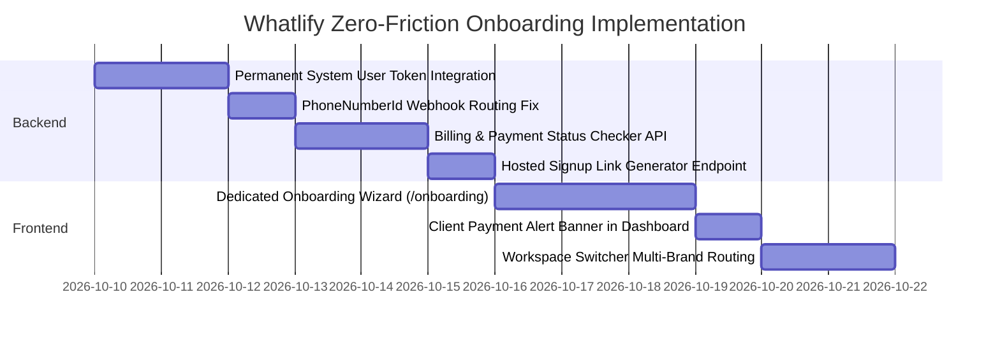

# Meta Tech Provider & Zero-Friction Client Onboarding Blueprint
**System:** Whatlify (WhatsApp-Hub-Suite)  
**Target:** 5-Minute Zero-Touch Onboarding for Client Brands (e.g., XYZ Clothing)  
**Status:** Architecture & Implementation Plan  

---

## Executive Summary: Is Whatlify Ready Right Now?

### The Short Answer:
**70% of the code foundation is already built, but it is NOT yet 100% production-ready for external clients.**

| Capability | Current State | Production Readiness | What's Missing? |
| :--- | :---: | :---: | :--- |
| **Meta Popup Trigger (FB.login)** | ✅ Built (`facebook-sdk.ts`) | **Ready** | None (loads SDK v21.0 & captures code). |
| **OAuth Code Exchange** | ✅ Built (`/api/whatsapp/embedded-signup`) | ⚠️ **Partial** | Exchanges code for **User Token** which expires in 60 days (or hours). Needs **System User Token / Permanent Token**. |
| **WABA & Phone ID Resolution** | ✅ Built | **Ready** | Auto-discovers `phone_number_id` and `waba_id`. |
| **Auto-Registration with PIN** | ✅ Built | **Ready** | Automatically registers phone number on Cloud API. |
| **Webhook Auto-Subscription** | ✅ Built (`POST /{waba_id}/subscribed_apps`) | ⚠️ **Partial** | Subscribes WABA, but inbound webhook router needs `phone_number_id` resolution. |
| **Client Payment / Card Check** | ❌ Missing | **Not Ready** | Does not verify if client added a card; outbound messages fail silently if billing is missing. |
| **Dedicated Onboarding Wizard** | ❌ Missing | **Not Ready** | Embedded Signup is hidden under Settings; no 3-step onboarding flow for new clients. |
| **Hosted Signup Link Generator** | ❌ Missing | **Not Ready** | Cannot send a direct onboarding URL via email/WhatsApp to the client. |

---

## 1. How the Flow Works: Client Perspective vs. Whatlify Engine

```mermaid
sequenceDiagram
    autonumber
    actor Client as XYZ Brand Owner
    participant Web as Whatlify Frontend
    participant Srv as Whatlify Server
    participant Meta as Meta Graph API / OAuth
    participant WABA as Meta WABA Cloud API

    Client->>Web: Clicks "Connect WhatsApp"
    Web->>Meta: Opens FB.login popup (config_id + sessionInfoVersion 3)
    Client->>Meta: Logs in to Facebook, Enters Brand Name & Phone Number
    Meta-->>Client: Sends 6-digit SMS OTP
    Client->>Meta: Enters OTP & Approves Whatlify Permissions
    Meta-->>Web: Returns OAuth Code, WABA ID, Phone Number ID
    Web->>Srv: POST /api/whatsapp/embedded-signup { code, wabaId, phoneNumberId }
    
    rect rgb(20, 30, 45)
        Note over Srv,Meta: Server-Side Tech Provider Heavy Lifting
        Srv->>Meta: 1. Exchange Code for Access Token
        Srv->>Meta: 2. Link WABA to Tech Provider Permanent System User
        Srv->>Meta: 3. Register Phone Number with Cloud API (PIN)
        Srv->>Meta: 4. POST /{waba_id}/subscribed_apps (Auto-attach Webhooks)
        Srv->>Meta: 5. Verify Client Payment Status (Card Added)
    end

    Srv->>Srv: Map WABA & Phone ID to XYZ Brand Workspace Container
    Srv-->>Web: HTTP 200 OK (Workspace Configured & Live!)
    Web-->>Client: Success! "Your WhatsApp is Live. Start Messaging."
```



---

## 2. The 5 Critical Technical Gaps to Fix

---

### Gap 1: Token Expiry (The #1 Production Killer)

#### The Danger:
Currently, Whatlify exchanges the authorization code for an access token:
```ts
const tokenUrl = `https://graph.facebook.com/v21.0/oauth/access_token?client_id=${appId}&client_secret=${appSecret}&code=${code}`;
```
This returns a **User Access Token**.
- A standard User Token expires in **1 to 2 hours**.
- Even a long-lived user token expires in **60 days**, or immediately if the brand owner changes their Facebook password or logs out.
- **When it expires, XYZ Brand's WhatsApp goes completely offline without warning.**

#### The Production Fix:
Because you are an approved **Tech Provider / Solution Partner**:
1. In your Meta Business Manager, create an **Admin System User** under *System Users* with `whatsapp_business_messaging` and `whatsapp_business_management` permissions.
2. Generate a **Permanent (Never-Expiring) System User Access Token**.
3. Save this in your server environment: `META_SYSTEM_USER_TOKEN`.
4. When XYZ Brand completes Embedded Signup, their WABA is automatically shared with your Tech Provider Business Portfolio.
5. Your server uses your `META_SYSTEM_USER_TOKEN` or exchanges the client's token for an assigned business asset token so Whatlify can send messages **forever without token renewals**.

---

### Gap 2: Inbound Webhook Routing by `phoneNumberId`

#### The Problem:
In `server/routes.ts`:
```ts
for (const entry of body.entry || []) {
  const wabaId = entry.id;
  const [container] = await db.select().from(containers)
    .where(eq(containers.wabaId, wabaId));
```
- In Meta, one WABA can have **multiple phone numbers** (e.g. Sales number, Support number).
- If XYZ Brand has multiple numbers in separate containers, looking up by `wabaId` routes messages to the wrong container!

#### The Fix:
Extract the exact recipient phone number ID from `metadata`:
```ts
const phoneNumberId = change.value?.metadata?.phone_number_id;
const [container] = await db.select().from(containers)
  .where(eq(containers.phoneNumberId, phoneNumberId));
```
If not found by `phoneNumberId`, fall back to `wabaId`. This guarantees 100% routing accuracy.

---

### Gap 3: Client Payment & Meta Conversation Billing Verification

#### The Problem:
Meta charges per conversation directly to the brand's card. If XYZ Brand skips adding their credit card during the popup, Meta sets their account to **Restricted / Payment Required**.
- The client tries to send a message from Whatlify inbox.
- Meta returns API error: `(#131031) Account payment issue: Please add a payment method to your WhatsApp Business account.`
- Client thinks Whatlify is broken.

#### The Fix:
Add an automatic post-signup billing check in `server/routes.ts`:
```ts
const billingRes = await fetch(`https://graph.facebook.com/v21.0/${resolvedWabaId}?fields=payment_method,account_review_status`, {
  headers: { Authorization: `Bearer ${permanentToken}` }
});
const billingData = await billingRes.json();
```
If no payment method is attached, display a banner in the client's dashboard:
> ⚠️ **Action Required by XYZ Brand:** Add a payment card in your Meta Business Suite to unlock outbound template broadcasts. [Add Card Link]

---

### Gap 4: Zero-Friction Client Onboarding Wizard (`/onboarding`)

#### The Problem:
Currently, the client has to:
1. Register on `/auth`.
2. Land on an empty dashboard.
3. Find the settings tab on the sidebar.
4. Click *API & Webhooks*.
5. Expand *WhatsApp Business API Settings*.
6. Click *Connect with Facebook*.

This creates high friction and confusion for non-technical brand owners.

#### The Fix: Dedicated 3-Step Wizard:
When a new user signs up:
- If their workspace has `isConfigured === false`, redirect them immediately to a clean `/onboarding` screen:
  - **Step 1:** *"Connect WhatsApp"* (Big green button: **Connect with Facebook**).
  - **Step 2:** Popup opens -> OTP -> Approved (1-Click).
  - **Step 3:** *"Congratulations, +92 300 1234567 is live!"* -> Button: **Open Team Inbox**.

---

### Gap 5: Direct Hosted Signup Link Generator

#### What This Is:
Meta allows Tech Providers to generate a pre-configured signup URL:
```
https://www.facebook.com/v21.0/dialog/oauth?
  client_id={YOUR_APP_ID}&
  redirect_uri=https://whatlify.com/api/whatsapp/oauth-callback&
  config_id={YOUR_CONFIG_ID}&
  state={CONTAINER_ID}
```
You can send this exact link to XYZ Brand over WhatsApp, Slack, or Email. They click the link on their browser or phone, authorize once, and their Whatlify workspace is automatically activated without them even touching the settings page!

---

## 3. Step-by-Step Implementation Action Plan



### Action Items Checklist

#### 1. Backend Hardening (`server/routes.ts` & `server/meta-partner.ts`)
- [ ] Add `META_SYSTEM_USER_TOKEN` support to bypass expiring user access tokens.
- [ ] Update `POST /api/webhook` to route by `metadata.phone_number_id` first.
- [ ] Add `GET /api/containers/:id/waba-status` to query Meta for:
  - Phone Number Quality Rating (`GREEN`, `YELLOW`, `RED`).
  - Daily Messaging Tier (`TIER_250`, `TIER_1K`, `TIER_10K`).
  - Payment Method Status (`ACTIVE`, `PENDING_CARD`).
- [ ] Add `POST /api/containers/:id/generate-invite-link` to produce direct hosted links for clients.

#### 2. Frontend Wizard (`client/src/pages/onboarding.tsx`)
- [ ] Build `/onboarding` page with a minimalist, high-trust UI.
- [ ] Auto-redirect unconfigured accounts upon login to `/onboarding`.
- [ ] Trigger Facebook SDK popup with live progress indicators (*"Verifying phone..."*, *"Connecting webhooks..."*, *"Ready!"*).
- [ ] Show phone number health badge in dashboard header (*"Quality: High • 250 msgs/day"*).

---

## 4. Summary: Client Experience After Implementing This Plan

When XYZ Brand signs up:
1. They create an account on `whatlify.com` in **30 seconds**.
2. They see a single button: **"Connect WhatsApp with Facebook"**.
3. They enter their brand name, phone number, and enter SMS OTP in **3 minutes**.
4. Meta links the number to your Tech Provider backend automatically.
5. They are taken straight to their live **Whatlify Team Inbox**.

**No documents, no developer accounts, no Meta approvals needed for the client. True 5-minute SaaS onboarding.**
